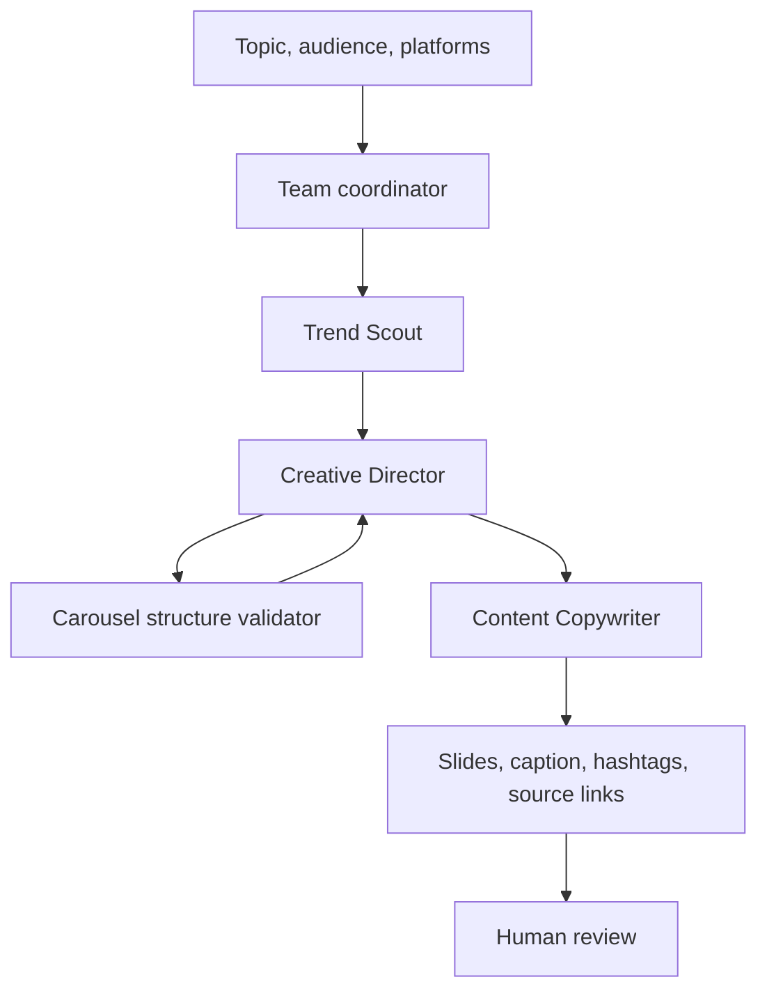

# Architecture

## Overview

AI Marketing Squad turns a topic, target audience, and platform list into a research-informed social carousel draft. The Agno team coordinates three agents; custom Python validation keeps the slide-count check deterministic.

## Components

### Trend Scout — `agents/trend_scout.py`

Searches for three timely, audience-relevant hooks and asks for source titles, URLs, and publication dates when available. It should separate source facts from recommendations and state when evidence is weak.

### Creative Director — `agents/creative_director.py`

Turns research into a slide-by-slide visual blueprint. It uses the deterministic carousel validator and revises plans that fall outside the configured minimum and maximum. The default range of 7–10 is a project design choice, not a performance guarantee.

### Content Copywriter — `agents/content_copywriter.py`

Writes clear, natural, audience-aware slide scripts, one caption, and ten relevant hashtags. It is instructed not to invent statistics, quotes, sources, or outcomes.

### Team coordination — `team.py`

Creates the Agno team and defines the research → blueprint → copy workflow. Provider imports are deferred so structural validation and tests can run without invoking live services.

### Configuration — `config.py`

Reads keys and configurable values from environment variables, optionally loading a local `.env`. Key values are never printed by this module.

### Validation and evaluation — `validation.py`

Implements deterministic slide-count validation and checks the completeness of normalized campaign payloads. These are structural checks only; they cannot verify factuality, source relevance, or marketing outcomes.

## Data flow

1. The CLI accepts a topic, audience, and platforms.
2. `generate_campaign` validates user inputs and constructs the task prompt.
3. The Agno coordinator delegates work across the specialized agents.
4. The Creative Director calls the slide-count tool.
5. The team returns a text draft for human review.
6. The separate evaluator can assess a normalized JSON campaign representation.

## Trust boundaries and failure cases

- Search snippets may be incomplete or misleading; open and verify source pages.
- Model output may contain unsupported claims despite instructions.
- Provider keys and API availability are external dependencies.
- The current CLI returns a text draft. It does not automatically persist campaign history or publish to social platforms.
- Errors during live runs depend on provider/network behavior and should be reviewed rather than silently treated as successful generations.

## Extending the system

Potential future improvements include structured model output, retries with bounded backoff, structured logging with secret redaction, campaign-specific quality rubrics, and capture of latency/token/cost data when the provider exposes it.
